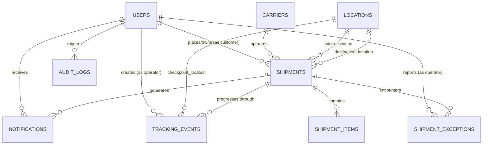

# CargoTrace — Global Shipment Visibility & Tracking Platform

[](https://laravel.com)
[](https://php.net)
[](https://mysql.com)
[](https://tailwindcss.com)
[](https://leafletjs.com)
[](#automated-testing-guide)

**CargoTrace** is an enterprise-grade multi-modal shipment visibility, operational intelligence, and tracking platform built with Laravel 12 and MySQL. Designed for modern global logistics providers, carriers, port operators, and freight consignees, CargoTrace provides real-time geospatial tracking, strict status state machine lifecycle progression, deterministic SLA delay detection, incident exception handling, external weather telemetry, and a complete Laravel Sanctum-powered REST API.

---

## Table of Contents

- [Architectural Overview](#architectural-overview)
- [Key Features](#key-features)
  - [1. Shipment Lifecycle State Machine](#1-shipment-lifecycle-state-machine)
  - [2. Deterministic ETA & SLA Delay Evaluation Engine](#2-deterministic-eta--sla-delay-evaluation-engine)
  - [3. Exception & Incident Lifecycle Management](#3-exception--incident-lifecycle-management)
  - [4. Interactive Route Map & Weather Telemetry](#4-interactive-route-map--weather-telemetry)
  - [5. Role-Based Access Control & Multi-Tenant Isolation](#5-role-based-access-control--multi-tenant-isolation)
  - [6. Operational KPI Dashboard & Advanced Query Console](#6-operational-kpi-dashboard--advanced-query-console)
  - [7. Comprehensive REST API & Postman Collection](#7-comprehensive-rest-api--postman-collection)
- [Database Schema & Entity Relationships](#database-schema--entity-relationships)
- [Demo User Accounts](#demo-user-accounts)
- [Installation & Setup](#installation--setup)
- [Automated Testing Guide](#automated-testing-guide)
- [Postman Collection Guide](#postman-collection-guide)
- [Technical Constraints & Assumptions](#technical-constraints--assumptions)

---

## Architectural Overview

CargoTrace follows a strict **Layered Architecture (Separation of Concerns)** to ensure business logic remains testable, decoupled, and reusable across both Blade web interfaces and REST API controllers:

```
[ HTTP Requests / API Clients ]
               │
               ▼
┌──────────────────────────────────────────────┐
│  Routes & Middleware                         │
│  - auth:web / auth:sanctum                   │
│  - EnsureUserHasRole (admin, operator, etc.) │
└──────────────────────┬───────────────────────┘
                       │
                       ▼
┌──────────────────────────────────────────────┐
│  FormRequests & Policies                     │
│  - StoreShipmentRequest, TrackingRequest     │
│  - ShipmentPolicy (multi-tenant boundary)    │
└──────────────────────┬───────────────────────┘
                       │
                       ▼
┌──────────────────────────────────────────────┐
│  Controllers (Web & Api)                     │
│  - Thin controllers: dispatch to services    │
│  - Returns Blade views or API Resources      │
└──────────────────────┬───────────────────────┘
                       │
                       ▼
┌──────────────────────────────────────────────┐
│  Service Layer (Domain Business Logic)       │
│  - ShipmentService (lifecycle & queries)     │
│  - TrackingService (events & timeline)       │
│  - EtaService (deterministic delay & SLA)    │
│  - ExceptionService (incidents & resolution) │
│  - WeatherService (Open-Meteo integration)   │
└──────────────────────┬───────────────────────┘
                       │
                       ▼
┌──────────────────────────────────────────────┐
│  Eloquent Models & Database Layer (MySQL)    │
│  - Transactions, Audit Logs & Notifications  │
└──────────────────────────────────────────────┘
```

- **Routes & Middleware**: Handles authentication, route binding, and role authorization (`auth:sanctum`, `role:admin,operator`, `role:customer`).
- **FormRequests**: Validates incoming payload shapes, data types, foreign keys, coordinates, and enum values before reaching controllers.
- **Controllers**: Thin controllers that delegate all business logic to the service layer.
- **Service Layer**: Self-contained business logic modules ensuring 100% feature and validation parity between web UI and REST API.
- **Eloquent Models**: Strongly typed relationships (`belongsTo`, `hasMany`), custom attributes, casts, and query scopes.
- **API Resources**: Strict JSON response contracts (`ShipmentResource`, `TrackingEventResource`, `ShipmentExceptionResource`) that prevent internal schema leakage.
- **Anti-Leak Exception Handler**: Centralized JSON error rendering in `bootstrap/app.php` providing structured envelopes (`401`, `403`, `404`, `422`, `500`) without exposing internal trace information.

---

## Key Features

### 1. Shipment Lifecycle State Machine

Shipments strictly adhere to an auditable sequential state machine:

$$\text{CREATED} \longrightarrow \text{BOOKED} \longrightarrow \text{PICKED\_UP} \longrightarrow \text{IN\_TRANSIT} \longrightarrow \text{DELIVERED}$$

- **State Progression Validation**: Transition rules defined in `Shipment::getAllowedTransitions()` prohibit skipping stages (e.g., jumping from `CREATED` directly to `IN_TRANSIT`).
- **Terminal Status Protection**: Once marked `DELIVERED`, the shipment is locked. Any reversal requires an Administrator role, explicit confirmation flag, and an auditable rationale (minimum 10 characters).
- **Incident Interruption**: Active exceptions allow transitioning to `EXCEPTION` or `CUSTOMS_HOLD` states without breaking chronological history.
- **Historical Event Append-Only Log**: Tracking events (`tracking_events`) never overwrite existing records. The current location is computed dynamically from the latest valid geospatial coordinate.

### 2. Deterministic ETA & SLA Delay Evaluation Engine

Delay calculation is fully deterministic, transparent, and reproducible based on contract SLAs:

- **Configurable SLA Threshold**: Configured via `config/cargotrace.php` (`DELAY_THRESHOLD_HOURS=12`) or `.env`.
- **Delay Duration**: Calculated as the difference in hours between `estimated_arrival` and contractual `expected_arrival`.
- **Severity Classification**:
  - `NONE`: Estimated arrival $\le$ expected arrival $+$ threshold buffer.
  - `LOW`: $0 < \text{excess hours} \le 6\text{h}$.
  - `MEDIUM`: $6 < \text{excess hours} \le 24\text{h}$.
  - `HIGH`: $\text{excess hours} > 24\text{h}$.
- **Automatic Recalculation**: Every new tracking event or shipment update triggers automated delay re-evaluation, audit logging, and customer notification dispatch.

### 3. Exception & Incident Lifecycle Management

- **Supported Exception Types**: `CUSTOMS_HOLD`, `WEATHER_DELAY`, `PORT_CONGESTION`, `DAMAGED`, `MISROUTED`, `DOCUMENTATION_ISSUE`.
- **Resolution Workflow**: `OPEN` $\longrightarrow$ `INVESTIGATING` $\longrightarrow$ `RESOLVED`.
- **Auditing**: Captures incident detection time (`detected_at`), resolution timestamp (`resolved_at`), investigating user, and resolution remarks.
- **Visual Timeline**: Exceptions are highlighted in the chronological tracking timeline with distinctive amber/rose badges and warning banners.

### 4. Interactive Route Map & Weather Telemetry

- **Interactive Leaflet.js Map**: Uses OpenStreetMap tiles with complete attribution (`© OpenStreetMap contributors`).
- **Geospatial Visualizations**: Renders green origin marker, red destination marker, blue waypoint checkpoints, and an animated dashed polyline representing voyage paths.
- **Live Weather Integration**: Queries the Open-Meteo REST API using origin, current location, or destination coordinates:
  - Fetches real-time temperature, wind speed, weather condition codes, and coordinates.
  - Zero hardcoded URLs or credentials (`config/cargotrace.php` + `.env`).
  - Graceful fallback with timeout protection (3-second connection, 5-second total) ensuring the page never crashes if external services are unreachable.
  - Explicitly presented as **operational context** rather than unverified AI/ML delay predictions.

### 5. Role-Based Access Control & Multi-Tenant Isolation

| Capability | Administrator | Logistics Operator | Customer (Consignee) |
|---|:---:|:---:|:---:|
| System Dashboard & Global KPIs | Full Grid | Full Grid | Tenant-Scoped Fleet |
| View Shipments | All Shipments | All Shipments | **Own Shipments Only** |
| Register New Shipment & Items | Yes | Yes | No (403 Forbidden) |
| Edit Shipment Details | Yes | Yes | No (403 Forbidden) |
| Add Tracking Event Checkpoints | Yes | Yes | No (403 Forbidden) |
| Create / Resolve Exceptions | Yes | Yes | Read-Only |
| Terminal Status Reversal | **Yes (Special Flow)** | No (Locked) | No (Locked) |
| Manage Master Data (Carriers / Locations) | Full CRUD | View Only | View Only |
| View Audit Logs | Yes | No | No |

- **Multi-Tenant Scoping**: Enforced at the Eloquent Service Layer (`$query->where('customer_id', $user->id)`) and double-checked by `ShipmentPolicy`.

### 6. Operational KPI Dashboard & Advanced Query Console

- **Role-Tailored KPI Cards**:
  - Global dispatchers see Total Active Fleet, Delayed Shipments, Critical Open Incidents, On-Time SLA Delivery Rate, and Status Distribution.
  - Customers see their isolated active freight count, on-schedule deliveries, and incident alerts.
- **Server-Side Filter Console**:
  - Full-text search (shipment number, cargo description, customer name).
  - Lifecycle Status dropdown.
  - Carrier selection.
  - Schedule health (Delayed vs. On-Time).
  - Delay severity tier (`NONE`, `LOW`, `MEDIUM`, `HIGH`).
  - Origin and Destination hub dropdowns.
  - Incident filter (Active Incidents vs. Incident-Free).
  - Expected departure date range (`departure_from` to `departure_to`).
  - Estimated arrival date range (`arrival_from` to `arrival_to`).
  - Clean query-string retaining pagination (`withQueryString()`).

### 7. Comprehensive REST API & Postman Collection

- Complete JSON endpoints for Authentication, Shipments, Tracking Events, Exceptions, Carriers, and Locations.
- Authentication via **Laravel Sanctum** bearer tokens.
- Fully documented Postman v2.1 collection located at [`docs/CargoTrace.postman_collection.json`](docs/CargoTrace.postman_collection.json).

---

## Database Schema & Entity Relationships

The schema is normalized, indexed on key query paths, and equipped with foreign key constraints:



### Table Reference
- `users`: Core identity table with `role` (`admin`, `operator`, `customer`).
- `carriers`: Freight lines (e.g., Maersk, MSC, DHL Global Forwarding) with SCAC/IATA code and status.
- `locations`: Global logistics hubs with code, city, country, latitude, and longitude.
- `shipments`: Core aggregate root storing shipment number, route, dimensions, dates, status, and computed delay metrics.
- `shipment_items`: Line items packed inside a consignment.
- `tracking_events`: Append-only historical event log with timestamps, coordinates, and operators.
- `shipment_exceptions`: Incidents causing voyage interruption with lifecycle status (`OPEN`, `INVESTIGATING`, `RESOLVED`).
- `notifications`: In-app notifications for consignees on status changes and exceptions.
- `audit_logs`: Detailed audit trail capturing actor, entity ID, action, old values, and new values.

---

## Demo User Accounts

The database seeder provisions demo accounts for each role with the password `password`:

| Role | Email | Password | Intended Use |
|---|---|---|---|
| **Administrator** | `admin@cargotrace.test` | `password` | Master carrier/location setup, audit logs, terminal reversal |
| **Logistics Operator** | `operator@cargotrace.test` | `password` | Registering cargo, posting tracking events, managing exceptions |
| **Customer (Consignee)** | `customer@cargotrace.test` | `password` | Tracking private consignments, viewing route maps & alerts |

---

## Installation & Setup

### Prerequisites
- PHP 8.2 or higher with `pdo_mysql`, `curl`, `mbstring`, `openssl` extensions
- Composer 2.x
- Node.js 18.x or higher & NPM
- MySQL 8.0+ or MariaDB 10.5+

### Step-by-Step Setup

1. **Clone or Navigate to the Workspace Directory**:
   ```bash
   cd c:\xampp\htdocs\cargotrace
   ```

2. **Install PHP Dependencies**:
   ```bash
   composer install
   ```

3. **Configure Environment File**:
   Copy `.env.example` to `.env`:
   ```bash
   cp .env.example .env
   ```
   Ensure your MySQL database credentials and CargoTrace configuration parameters are configured in `.env`:
   ```env
   DB_CONNECTION=mysql
   DB_HOST=127.0.0.1
   DB_PORT=3306
   DB_DATABASE=cargotrace
   DB_USERNAME=root
   DB_PASSWORD=

   DELAY_THRESHOLD_HOURS=12
   OPEN_METEO_BASE_URL=https://api.open-meteo.com/v1/forecast
   OPEN_METEO_TIMEOUT=5
   ```

4. **Generate Application Key**:
   ```bash
   php artisan key:generate
   ```

5. **Run Database Migrations & Seeders**:
   ```bash
   php artisan migrate:fresh --seed
   ```

6. **Install Frontend Dependencies & Build Assets**:
   ```bash
   npm install
   npm run build
   ```

7. **Start the Local Development Server**:
   ```bash
   php artisan serve
   ```
   Access the web interface at `http://localhost:8000`.

---

## Automated Testing Guide

CargoTrace includes a 100% passing automated test suite with **53 test cases** and **297 assertions** covering unit rules, service layer interactions, HTTP policies, and API contracts.

### Running Tests

Execute all automated tests via PHPUnit / Artisan:

```bash
php artisan test
```

### Test Suite Organization

| Test Suite File | Focus Area | Assertions |
|---|---|:---:|
| [`tests/Feature/ShipmentLifecycleAndTimelineTest.php`](file:///c:/xampp/htdocs/cargotrace/tests/Feature/ShipmentLifecycleAndTimelineTest.php) | Sequential state transitions, rejection of invalid transitions, terminal `DELIVERED` lock, and historical timeline ordering. | 35+ |
| [`tests/Feature/ServiceLayerTest.php`](file:///c:/xampp/htdocs/cargotrace/tests/Feature/ServiceLayerTest.php) | Deterministic delay calculations across all severity tiers, custom thresholds, item packing, and notification dispatch. | 25+ |
| [`tests/Feature/ShipmentFilterAndSearchTest.php`](file:///c:/xampp/htdocs/cargotrace/tests/Feature/ShipmentFilterAndSearchTest.php) | Server-side search, multi-attribute filters (origin, destination, status, severity, dates), and customer multi-tenant isolation. | 80+ |
| [`tests/Feature/FullRestApiTest.php`](file:///c:/xampp/htdocs/cargotrace/tests/Feature/FullRestApiTest.php) | Sanctum token auth, API pagination, CRUD operations, exception patching, carrier/location master endpoints, and JSON error envelope verification. | 115+ |
| [`tests/Feature/WeatherAndMapIntegrationTest.php`](file:///c:/xampp/htdocs/cargotrace/tests/Feature/WeatherAndMapIntegrationTest.php) | Open-Meteo external HTTP integration, timeout and 5xx error fallback handling, and Leaflet coordinate rendering. | 20+ |
| [`tests/Feature/RoleAuthorizationTest.php`](file:///c:/xampp/htdocs/cargotrace/tests/Feature/RoleAuthorizationTest.php) | Web middleware role gates (`admin`, `operator`, `customer`) and data isolation between customers. | 15+ |

To run a specific test suite:
```bash
php artisan test tests/Feature/ShipmentFilterAndSearchTest.php
```

---

## Postman Collection Guide

A complete, pre-configured Postman collection is available at:
[`docs/CargoTrace.postman_collection.json`](docs/CargoTrace.postman_collection.json)

### Importing into Postman
1. Open Postman.
2. Click **Import** in the upper left corner.
3. Select or drag the file `docs/CargoTrace.postman_collection.json`.
4. Ensure the collection variable `base_url` is set to `http://localhost:8000` (or your local development URL).

### Authentication in Postman
1. Run the **Auth > Operator Login** or **Auth > Customer Login** request.
2. The collection includes a post-response test script that automatically extracts `bearer_token` from the response JSON and sets it into the collection variable:
   ```javascript
   if (pm.response.code === 200) {
       var jsonData = pm.response.json();
       pm.collectionVariables.set("bearer_token", jsonData.token);
   }
   ```
3. All subsequent requests in the collection automatically inherit this Bearer Token.

---

## Technical Constraints & Assumptions

1. **Weather Telemetry as Operational Context**:
   - Real-time weather data retrieved via Open-Meteo is provided as live operational context to help human operators evaluate sailing and transit conditions.
   - It is explicitly not marketed or modeled as an unverified machine-learning predictive delay engine. All delay evaluations remain strictly deterministic and auditable based on scheduled arrival versus estimated arrival timestamps.

2. **Deterministic Delay vs. Dynamic ETA**:
   - The platform calculates delay severity (`LOW`, `MEDIUM`, `HIGH`) strictly by comparing `estimated_arrival` against `expected_arrival` offset against the configurable threshold (`DELAY_THRESHOLD_HOURS=12`).
   - This ensures full auditability for contractual SLA claims, preventing arbitrary or non-reproducible calculations.

3. **Terminal Reversal Governance**:
   - The status `DELIVERED` represents contractual fulfillment. Reverting a delivered shipment to an earlier status cannot be performed through regular operator interfaces and requires Administrator authentication with a mandatory justification log to prevent fraudulent billing disputes.

4. **External API Resilience**:
   - External dependencies (e.g., Open-Meteo) are treated as transient. Connection timeouts (3s) and read timeouts (5s) are enforced. The application gracefully degrades by displaying cached data or user-friendly fallback notices without interrupting critical logistics tracking.
