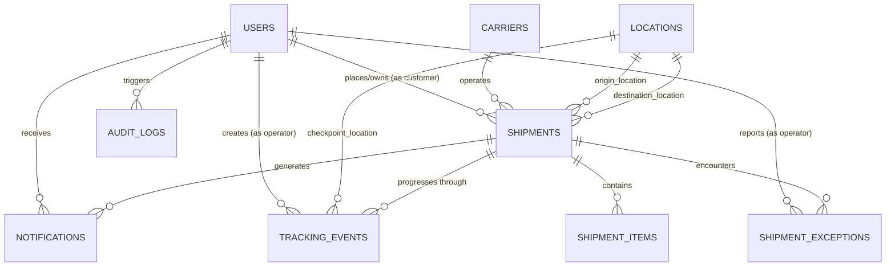

# CargoTrace — Global Shipment Visibility & Tracking Platform

[](https://laravel.com)
[](https://php.net)
[](https://mysql.com)
[](https://tailwindcss.com)
[](https://leafletjs.com)
[](#automated-testing-guide)
[](https://cargotrace-production-eeb7c991.up.railway.app)

**CargoTrace** is an enterprise-grade multi-modal shipment visibility, operational intelligence, and cargo tracking platform built on **Laravel 12** and **MySQL 8.0**. Designed for international shipping lines, freight airlines, transshipment hubs, logistics operators, and global cargo consignees, CargoTrace delivers end-to-end voyage traceability, deterministic SLA delay detection, incident exception workflows, interactive geospatial mapping via **Leaflet.js**, real-time environmental weather telemetry via **Open-Meteo**, bilingual localization (**English & Indonesian**), and a comprehensive **Laravel Sanctum-powered REST API**.

---

## Live Deployment & Demonstration

The application is deployed and publicly accessible in a cloud production environment:

- **Live URL:** [https://cargotrace-production-eeb7c991.up.railway.app](https://cargotrace-production-eeb7c991.up.railway.app)
- **Deployment Platform:** Railway (PHP 8.2 runtime, Nginx, MySQL 8.0, HTTPS SSL/TLS)

---

## Table of Contents

- [Live Deployment & Demonstration](#live-deployment--demonstration)
- [Project Overview & Key Capabilities](#project-overview--key-capabilities)
- [UI & Authentication Design](#ui--authentication-design)
- [Architectural Overview](#architectural-overview)
- [Seeded Demo Accounts](#seeded-demo-accounts)
- [Domain Features & Business Rules](#domain-features--business-rules)
  - [1. Shipment Lifecycle State Machine](#1-shipment-lifecycle-state-machine)
  - [2. Deterministic ETA & SLA Delay Evaluation Engine](#2-deterministic-eta--sla-delay-evaluation-engine)
  - [3. Exception & Incident Lifecycle Management](#3-exception--incident-lifecycle-management)
  - [4. Interactive Route Map & Weather Telemetry](#4-interactive-route-map--weather-telemetry)
  - [5. Role-Based Access Control & Multi-Tenant Data Isolation](#5-role-based-access-control--multi-tenant-data-isolation)
  - [6. Operational KPI Dashboard & Query Filter Console](#6-operational-kpi-dashboard--query-filter-console)
  - [7. Bilingual Localization Support (EN / ID)](#7-bilingual-localization-support-en--id)
  - [8. Comprehensive REST API & Postman Collection](#8-comprehensive-rest-api--postman-collection)
- [Database Schema & Entity Relationships](#database-schema--entity-relationships)
- [Installation & Local Setup](#installation--local-setup)
- [Automated Testing Guide](#automated-testing-guide)
- [Postman Collection Guide](#postman-collection-guide)
- [Technical Constraints & Assumptions](#technical-constraints--assumptions)

---

## Project Overview & Key Capabilities

CargoTrace solves critical visibility challenges across international supply chains by unifying fragmented operational data into a single coherent portal:

1. **Interactive Geospatial Mapping (Leaflet.js + OpenStreetMap)**: Real-time map rendering displaying origin seaports/airports, sequential voyage checkpoints, and destination terminals with color-coded coordinate markers, traveled polyline corridors, and interactive checkpoint telemetry popups.
2. **Environmental & Weather Telemetry (Open-Meteo)**: Live maritime and cargo-terminal weather observations (temperature, wind velocity, humidity, and atmospheric conditions) integrated as operational decision context with resilient timeout safeguards and graceful offline fallbacks.
3. **Bilingual Localization (English & Indonesian)**: Native language switching (`en` / `id`) across all web portal interfaces (navigation, dashboard KPIs, shipment registry, advanced filter drawer, exception management, and consignment details).
4. **Role-Based Access Control (RBAC)**: Distinct user journeys and strict policy boundaries for **Administrators**, **Logistics Operators**, and **Customer Consignees**.
5. **Deterministic Delay & SLA Engine**: Transparent, formula-based calculation of schedule delays against contractual thresholds, assigning auditable delay severity levels without unverified heuristic claims.

---

## UI & Authentication Design

### Modern Deep Violet & Pink Palette
CargoTrace features a modern dark-mode aesthetic built with Tailwind CSS, utilizing high-contrast typography and semantic color separation:

- **Primary Background**: Deep Violet (`#120b24` / `bg-[#120b24]`).
- **Surface & Cards**: Medium Violet Surface (`#1c1236` / `bg-[#1c1236]`) bounded by soft violet borders (`#33215c` / `border-[#33215c]`) and subtle hover states (`#291a4d` / `#3d276e`).
- **Primary & Accent Buttons**: Modern Vibrant Pink (`#ec4899` / `pink-500`, hover `#f472b6` / `pink-400`) combined with fuchsia gradients (`from-pink-500 via-fuchsia-500 to-rose-600`) for primary action buttons, active navigation pills, Leaflet route waypoints, and focus rings (`focus:ring-pink-500`).
- **Typography & Readability**: High-contrast light text (`#f8fafc`, `#e2e8f0`, `text-white`, `text-slate-100`) for headers and primary data, with balanced neutral slate (`text-slate-300`, `text-slate-400`) for secondary metadata and descriptions.
- **Operational Semantic Status Separation**:
  - **Emerald (`emerald-400`/`emerald-500`)**: Safe status, delivered shipments, compliant SLAs, and origin terminals.
  - **Amber (`amber-400`/`amber-500`)**: Schedule delays, moderate warnings, and incidents currently under investigation.
  - **Rose / Red (`rose-500`/`red-500`)**: Critical delays, severe exceptions, incident markers, and terminal disruption alerts.

### Authentication & Manual Credential Entry
In accordance with production security standards, all quick-fill / one-click demo login buttons have been intentionally removed from the login interface. Users authenticate by typing credentials manually into standard email and password input fields, which submit to the authenticated web session controller with CSRF protection, rate limiting, and password hashing.

---

## Architectural Overview

CargoTrace follows a strict **Layered Architecture (Separation of Concerns)** to ensure business logic remains testable, decoupled, and consistent across both Blade web interfaces and REST API controllers:

```
[ HTTP Requests / API Clients ]
               │
               ▼
┌──────────────────────────────────────────────┐
│  Routes & Middleware                         │
│  - auth:web / auth:sanctum                   │
│  - SetLocale (en / id session resolution)    │
│  - EnsureUserHasRole (admin, operator, etc.) │
└──────────────────────┬───────────────────────┘
                       │
                       ▼
┌──────────────────────────────────────────────┐
│  FormRequests & Policies                     │
│  - StoreShipmentRequest, TrackingRequest     │
│  - ShipmentPolicy (multi-tenant boundary)    │
└──────────────────────┬───────────────────────┘
                       │
                       ▼
┌──────────────────────────────────────────────┐
│  Controllers (Web & Api)                     │
│  - Thin controllers: dispatch to services    │
│  - Returns Blade views or API Resources      │
└──────────────────────┬───────────────────────┘
                       │
                       ▼
┌──────────────────────────────────────────────┐
│  Service Layer (Domain Business Logic)       │
│  - ShipmentService (lifecycle & queries)     │
│  - TrackingService (events & timeline)       │
│  - EtaService (deterministic delay & SLA)    │
│  - ExceptionService (incidents & resolution) │
│  - WeatherService (Open-Meteo integration)   │
└──────────────────────┬───────────────────────┘
                       │
                       ▼
┌──────────────────────────────────────────────┐
│  Eloquent Models & Database Layer (MySQL)    │
│  - Transactions, Audit Logs & Notifications  │
└──────────────────────────────────────────────┘
```

- **Routes & Middleware**: Handles authentication, web/API session resolution, language switching (`SetLocale`), and role access gates (`EnsureUserHasRole`).
- **FormRequests**: Validates incoming payload shapes, data types, foreign keys, coordinates, and enum values prior to controller execution.
- **Controllers**: Thin orchestration endpoints delegating domain processing directly to the service layer.
- **Service Layer**: Self-contained business logic modules ensuring 100% feature and validation parity between the web UI and REST API.
- **Eloquent Models**: Strongly typed relationships (`belongsTo`, `hasMany`), attribute casts, and query scopes.
- **API Resources**: Strict JSON response transformations (`ShipmentResource`, `TrackingEventResource`, `ShipmentExceptionResource`) that prevent schema leakage.
- **Centralized Exception Handler**: Structured JSON error envelopes in `bootstrap/app.php` (`401`, `403`, `404`, `422`, `500`) with zero sensitive stack trace exposure in production.

---

## Seeded Demo Accounts

The database seeder (`database/seeders/DatabaseSeeder.php`) pre-provisions test accounts across all roles. The default password for all demo accounts is `password`:

| Role | Email Address | Password | Permissions & Intended Scope |
|---|---|---|---|
| **Administrator** | `admin@cargotrace.test` | `password` | Global platform administration, master carrier & location CRUD, regulatory audit log inspection, and delivered status reversal procedures. |
| **Logistics Operator** | `operator@cargotrace.test` | `password` | Freight consignment registration, item manifest entry, tracking checkpoint logging, and exception incident reporting/resolution. |
| **Customer (Consignee 1)** | `customer@cargotrace.test` | `password` | Multi-tenant customer account for **Astra Global Tech Logistik**. Restricted strictly to own consignments, timeline view, and notifications. |
| **Customer (Consignee 2)** | `customer2@cargotrace.test` | `password` | Multi-tenant customer account for **EuroNordic Trading BV**. Verifies multi-tenant isolation and strict privacy boundary against Customer 1. |

---

## Domain Features & Business Rules

### 1. Shipment Lifecycle State Machine
Consignments strictly follow a validated sequential state machine:

$$\text{CREATED} \longrightarrow \text{BOOKED} \longrightarrow \text{PICKED\_UP} \longrightarrow \text{IN\_TRANSIT} \longrightarrow \text{DELIVERED}$$

- **State Progression Validation**: Rules defined in `Shipment::getAllowedTransitions()` prohibit skipping stages (e.g., jumping from `CREATED` directly to `IN_TRANSIT`).
- **Terminal Status Lock**: Once marked `DELIVERED`, the shipment is locked. Any reversal requires an Administrator role, explicit confirmation, and a mandatory justification log (minimum 10 characters).
- **Incident Interruption**: Active exceptions allow transitioning to `EXCEPTION` or `CUSTOMS_HOLD` states without breaking chronological history.
- **Append-Only Historical Timeline**: Checkpoints in `tracking_events` never overwrite past records. Current position is derived from the latest valid geospatial event.

### 2. Deterministic ETA & SLA Delay Evaluation Engine
Delay evaluation is fully transparent, predictable, and reproducible:

- **Configurable SLA Threshold**: Configured via `config/cargotrace.php` (`DELAY_THRESHOLD_HOURS=12`) or `.env`.
- **Delay Duration**: Calculated as the difference in hours between `estimated_arrival` and contractual `expected_arrival`.
- **Severity Classification**:
  - `NONE`: Estimated arrival $\le$ expected arrival $+$ threshold buffer.
  - `LOW`: $0 < \text{excess hours} \le 6\text{h}$.
  - `MEDIUM`: $6 < \text{excess hours} \le 24\text{h}$.
  - `HIGH`: $\text{excess hours} > 24\text{h}$.
- **Automatic Recalculation**: Every new tracking event or shipment update triggers automated delay re-evaluation, audit logging, and customer notification dispatch.

### 3. Exception & Incident Lifecycle Management
- **Canonical Exception Types**: `CUSTOMS_HOLD`, `WEATHER_DELAY`, `PORT_CONGESTION`, `DAMAGED`, `MISROUTED`, `DOCUMENTATION_ISSUE`.
- **Workflow Stages**: `OPEN` $\longrightarrow$ `INVESTIGATING` $\longrightarrow$ `RESOLVED`.
- **Traceability**: Captures detection timestamp (`detected_at`), resolution timestamp (`resolved_at`), investigating user, and resolution remarks.
- **Visual Alerting**: Incidents are prominently highlighted in the timeline with amber/rose badges and warning notices.

### 4. Interactive Route Map & Weather Telemetry
- **Leaflet.js & OpenStreetMap**: Interactive geospatial map rendered with complete OSM attribution (`© OpenStreetMap contributors`).
- **Geospatial Markers**: Renders emerald origin marker, blue destination marker, vibrant pink waypoint markers, and an animated dashed polyline representing voyage paths.
- **Live Weather Telemetry**: Queries Open-Meteo REST API using coordinates:
  - Fetches temperature, wind velocity, humidity, and weather conditions.
  - Zero hardcoded URLs or credentials (`config/cargotrace.php` + `.env`).
  - Resilient timeout protection (3s connection, 5s total) with graceful offline fallback.
  - Presented strictly as **operational context** rather than unverified machine-learning claims.

### 5. Role-Based Access Control & Multi-Tenant Data Isolation

| Capability | Administrator | Logistics Operator | Customer (Consignee) |
|---|:---:|:---:|:---:|
| System Dashboard & Global KPIs | Full Grid | Full Grid | Tenant-Scoped Fleet |
| View Shipments | All Shipments | All Shipments | **Own Shipments Only** |
| Register New Shipment & Items | Yes | Yes | No (403 Forbidden) |
| Edit Shipment Details | Yes | Yes | No (403 Forbidden) |
| Add Tracking Event Checkpoints | Yes | Yes | No (403 Forbidden) |
| Create / Resolve Exceptions | Yes | Yes | Read-Only |
| Terminal Status Reversal | **Yes (Special Flow)** | No (Locked) | No (Locked) |
| Manage Master Carriers & Locations | Full CRUD | View Only | View Only |
| View Audit Logs | Yes | No | No |

- **Multi-Tenant Scoping**: Enforced at the Eloquent Service Layer (`$query->where('customer_id', $user->id)`) and double-checked by `ShipmentPolicy`.

### 6. Operational KPI Dashboard & Query Filter Console
- **Role-Tailored KPI Cards**: Displays Active Fleet, Delayed Consignments, Critical Open Incidents, On-Time SLA Delivery Rate, and Status Distribution.
- **Server-Side Filter Console**: Supports full-text search, lifecycle status, carrier, delay status, delay severity tier, origin/destination hubs, open incidents, and departure/arrival date ranges with clean pagination (`withQueryString()`).

### 7. Bilingual Localization Support (EN / ID)
- Supported languages: **English (`en`)** and **Indonesian (`id`)**.
- Switcher route: `GET /locale/{locale}` validating against supported locales and storing preference in session.
- Middleware: `App\Http\Middleware\SetLocale` registered globally in `bootstrap/app.php`.
- Translations: Maintained in `lang/en/messages.php` and `lang/id/messages.php`.
- Decoupled API: REST API endpoints remain unaffected by web locale session and return standard ISO payload schemas.

### 8. Comprehensive REST API & Postman Collection
- RESTful JSON endpoints for Auth, Shipments, Tracking Events, Exceptions, Carriers, and Locations.
- Authenticated via **Laravel Sanctum** bearer tokens.
- Complete Postman collection located at [`docs/CargoTrace.postman_collection.json`](docs/CargoTrace.postman_collection.json).

---

## Database Schema & Entity Relationships

The schema is normalized, indexed on key query paths, and equipped with foreign key constraints:



### Table Reference
- `users`: Core identity table with `role` (`admin`, `operator`, `customer`).
- `carriers`: Freight lines (e.g., Maersk, MSC, DHL Global Forwarding) with SCAC/IATA code and status.
- `locations`: Global logistics hubs with UN/LOCODE, city, country, latitude, and longitude.
- `shipments`: Core aggregate root storing shipment number, route, dimensions, dates, status, and computed delay metrics.
- `shipment_items`: Line items packed inside a consignment.
- `tracking_events`: Append-only historical event log with timestamps, coordinates, and operators.
- `shipment_exceptions`: Incidents causing voyage interruption with lifecycle status (`OPEN`, `INVESTIGATING`, `RESOLVED`).
- `notifications`: In-app notifications for consignees on status changes and exceptions.
- `audit_logs`: Detailed audit trail capturing actor, entity ID, action, old values, and new values.

---

## Installation & Local Setup

### Prerequisites
- **PHP 8.2** or higher with extensions: `pdo_mysql`, `curl`, `mbstring`, `openssl`, `bcmath`, `xml`
- **Composer 2.x**
- **Node.js 18.x / 20.x** & **NPM**
- **MySQL 8.0+** or MariaDB 10.5+

### Step-by-Step Installation

1. **Clone or Navigate to the Project Root**:
   ```bash
   cd c:\xampp\htdocs\cargotrace
   ```

2. **Install Composer Dependencies**:
   ```bash
   composer install
   ```

3. **Configure Environment File**:
   Copy `.env.example` to `.env`:
   ```bash
   cp .env.example .env
   ```
   Configure your database credentials and CargoTrace parameters in `.env`:
   ```env
   APP_NAME=CargoTrace
   APP_ENV=local
   APP_KEY=
   APP_DEBUG=true
   APP_URL=http://localhost:8000

   DB_CONNECTION=mysql
   DB_HOST=127.0.0.1
   DB_PORT=3306
   DB_DATABASE=cargotrace
   DB_USERNAME=root
   DB_PASSWORD=

   # CargoTrace Operational Configuration
   DELAY_THRESHOLD_HOURS=12
   OPEN_METEO_BASE_URL=https://api.open-meteo.com/v1/forecast
   OPEN_METEO_TIMEOUT=5
   ```

4. **Generate Application Key**:
   ```bash
   php artisan key:generate
   ```

5. **Run Database Migrations and Seeders**:
   ```bash
   php artisan migrate:fresh --seed
   ```
   *This seeds test accounts, carriers, ports/hubs, active shipments, item manifests, tracking milestones, and exceptions.*

6. **Install Node Dependencies & Compile Assets**:
   ```bash
   npm install
   npm run build
   ```

7. **Start the Local Development Server**:
   ```bash
   php artisan serve
   ```
   Open your browser and navigate to:
   ```
   http://localhost:8000
   ```

---

## Automated Testing Guide

CargoTrace includes a 100% passing automated test suite with **60 test cases** and **335 assertions** covering unit rules, service layer interactions, HTTP policies, multi-tenant isolation, localization, and REST API contracts.

### Running the Full Test Suite
Execute tests via PHPUnit / Artisan:

```bash
php artisan test
```

### Test Suite Breakdown

| Test Suite File | Focus Area | Assertions |
|---|---|:---:|
| [`tests/Feature/ShipmentLifecycleAndTimelineTest.php`](tests/Feature/ShipmentLifecycleAndTimelineTest.php) | Sequential state transitions, rejection of invalid transitions, terminal `DELIVERED` lock, and historical timeline ordering. | 35+ |
| [`tests/Feature/ServiceLayerTest.php`](tests/Feature/ServiceLayerTest.php) | Deterministic delay calculations across all severity tiers, custom thresholds, item packing, and notification dispatch. | 25+ |
| [`tests/Feature/ShipmentFilterAndSearchTest.php`](tests/Feature/ShipmentFilterAndSearchTest.php) | Server-side search, multi-attribute filters (origin, destination, status, severity, dates), and customer multi-tenant isolation. | 80+ |
| [`tests/Feature/FullRestApiTest.php`](tests/Feature/FullRestApiTest.php) | Sanctum token auth, API pagination, CRUD operations, exception patching, carrier/location master endpoints, and JSON error envelope verification. | 115+ |
| [`tests/Feature/WeatherAndMapIntegrationTest.php`](tests/Feature/WeatherAndMapIntegrationTest.php) | Open-Meteo external HTTP integration, timeout and 5xx error fallback handling, and Leaflet coordinate rendering. | 20+ |
| [`tests/Feature/RoleAuthorizationTest.php`](tests/Feature/RoleAuthorizationTest.php) | Web middleware role gates (`admin`, `operator`, `customer`) and data isolation between customers. | 15+ |
| [`tests/Feature/LocalizationTest.php`](tests/Feature/LocalizationTest.php) | Bilingual session switching (`en` / `id`), translation rendering, invalid locale fallback, and API decoupling. | 20+ |
| [`tests/Feature/AuthTest.php`](tests/Feature/AuthTest.php) | Web authentication, credential validation, session login, and logout. | 10+ |

To execute an individual test suite:
```bash
php artisan test tests/Feature/LocalizationTest.php
```

---

## Postman Collection Guide

A complete, pre-configured Postman v2.1 collection is available at:
[`docs/CargoTrace.postman_collection.json`](docs/CargoTrace.postman_collection.json)

### Importing into Postman
1. Open Postman.
2. Click **Import** in the top navigation.
3. Select or drag the file [`docs/CargoTrace.postman_collection.json`](docs/CargoTrace.postman_collection.json).
4. Set the collection variable `base_url` to `http://localhost:8000` (or `https://cargotrace-production-eeb7c991.up.railway.app` for the live environment).

### Automated Token Inheritance
1. Execute the **Auth > Operator Login** or **Auth > Customer Login** request.
2. The collection includes a post-response test script that automatically extracts the Sanctum `bearer_token` from the response JSON and saves it to collection variables:
   ```javascript
   if (pm.response.code === 200) {
       var jsonData = pm.response.json();
       pm.collectionVariables.set("bearer_token", jsonData.token);
   }
   ```
3. All subsequent requests in the collection automatically inherit this Bearer Token.

---

## Technical Constraints & Assumptions

1. **Weather Telemetry as Operational Decision Context**:
   - Real-time weather data retrieved via Open-Meteo is provided as live operational context to assist logistics dispatchers and vessel operators in evaluating sea/terminal conditions.
   - It is explicitly not modeled as an unverified machine-learning predictive delay engine. All delay evaluations remain strictly deterministic and auditable based on scheduled arrival versus estimated arrival timestamps.

2. **Deterministic Delay vs. Dynamic ETA**:
   - The platform calculates delay severity (`NONE`, `LOW`, `MEDIUM`, `HIGH`) strictly by comparing `estimated_arrival` against contractual `expected_arrival` offset against the configurable threshold (`DELAY_THRESHOLD_HOURS=12`).
   - This ensures full auditability for contractual SLA claims, preventing arbitrary or non-reproducible calculations.

3. **Terminal Reversal Governance**:
   - The status `DELIVERED` represents contractual fulfillment. Reverting a delivered shipment to an earlier status cannot be performed through regular operator interfaces and requires Administrator authentication with a mandatory justification log to prevent fraudulent billing disputes.

4. **External API Resilience & Graceful Degradation**:
   - External dependencies (e.g., Open-Meteo) are treated as transient. Connection timeouts (3s) and read timeouts (5s) are enforced. The application gracefully degrades by displaying cached data or user-friendly fallback notices without interrupting critical logistics tracking.
